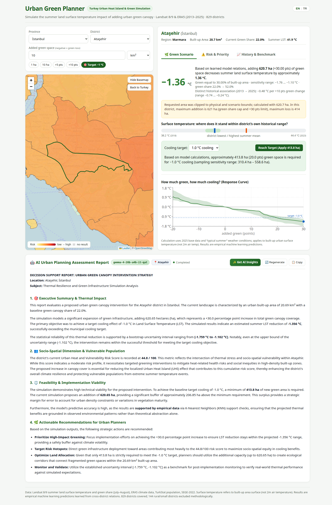

# Urban Heat Analysis Studio

[](LICENSE)


<!-- The "tests" badge is a fixed picture: there is no CI. Change it by hand if the tests ever fail. -->

What surface-temperature changes does a model associate with more green space in a Turkish district, and where might planning priorities lie? The project estimates this for **829 of the 973 districts** (80 of 81 provinces) with satellite data (Landsat surface temperature and greenness, 2013-2025), ERA5 weather, TÜİK population and the SEGE development index.

<p align="center">
  
</p>

## What is in the repository
| Folder | What |
| :--- | :--- |
| `notebooks/` | The whole analysis, in this order: `preprocessing.ipynb` → `eda.ipynb` → `modeling.ipynb` → `whatif.ipynb` → `risk.ipynb`; `explain.ipynb` (SHAP and ablation of the final model) can be run after `modeling.ipynb` (see `notebooks/README.md`) |
| `backend/` | FastAPI service: runs the final model live without reading result files (see Backend section below) |
| `frontend/` | React 19 + Vite Decision Support Studio: interactive risk map, what-if simulator and benchmark charts (see Frontend section below) |
| `data/` | `processed/`, `models/` and `results/` (see `data/README.md`); `data/data_package.zip` (31.8 MB) is provided in the repository and can be unpacked with `unzip data/data_package.zip -d data/` to instantly provide `processed/`, `models/`, and `results/` |

Everything runs in one conda environment (`environment.yml`). The app: `python -m uvicorn backend.main:app --port 8000` from the project root.

## Application Architecture & Development

<details>
<summary><b>🔧 Backend (FastAPI & Live Model Service)</b> — <i>Click to expand</i></summary>

### Overview
The backend runs the final model built by `notebooks/modeling.ipynb` live: no result files (`data/results/*.csv`) are read and nothing is trained inside this service. At startup (~2 seconds) it reads `data/processed/`, builds the district baseline states, and calculates the multicriteria risk table. Average request latency is ~15 ms.

### Running & Testing
```bash
# From project root in conda environment (urban-green-planner):
python -m uvicorn backend.main:app --port 8000      # serves API and frontend/dist
python -m backend.tests.parity                      # 9/9 parity checks against notebooks
python -m unittest discover -s backend/tests -p 'test_*.py'  # 19/19 unit tests (including prompt rendering and SSE stream mock)
```

### API Endpoints
| Method & Path | Description |
| :--- | :--- |
| `GET /api/health` | Service health, algorithm name, total valid districts (829) |
| `GET /api/meta` | Province and district hierarchy with bounding boxes and exclusion reasons |
| `GET /api/district/{code}` | District baseline, 2013–2025 measured history, city/national medians, risk breakdown |
| `POST /api/whatif` | Request `{district_code, amount, unit, cooling}` → live cooling effect, bootstrap sensitivity range, response curve (-20 to +30 pts), and sufficient target hectares |
| `POST /api/llm/interpret` | Stream real-time urban planning advisory report from local or API LLMs via Server-Sent Events (SSE) |
| `GET /api/top-risk?n=20` | Top vulnerable urban districts ranked by risk score |
| `GET /api/geo/overview` | Simplified GeoJSON of all 973 districts with ETag caching (304 Not Modified) |
| `GET /api/geo/district/{code}` | High-resolution GeoJSON polygon of a single district |

### Architecture Modules
- `backend/main.py`: FastAPI routes, CORS, gzip middleware, ETag validation, and static asset serving.
- `backend/planner/service.py`: Central `Planner` coordinator initializing memory tables, bounds, and risk tables.
- `backend/planner/whatif.py`: What-If simulation engine, native XGBoost wrapper (`AirTemperatureOffset`), sufficient-step target solver (`points_needed`), and bootstrap sensitivity bounds.
- `backend/planner/data.py`: Prepares base rows, 5-year rolling climate context, and within-city de-meaning (`..._vs_city`).
- `backend/planner/risk.py`: Multicriteria risk scorecard (Hazard, Exposure, Vulnerability) and Dirichlet weight sensitivity (500 permutations).
- `backend/planner/support.py`: KNN-based observational joint support checks.
- `backend/planner/llm.py`: AsyncOpenAI client, LLMSettings, and SSE streaming generator.
- `backend/prompts/interpretation.yaml`: Structured prompt templates (TR/EN) for senior urban planner & climate specialist persona.

### Optional Docker Deployment
```bash
# Using Docker Compose (builds and runs self-contained container)
docker compose up --build

# Or using plain Docker CLI:
docker build -t urban-heat-analysis-studio .
docker run --rm -p 8000:8000 urban-heat-analysis-studio
```

</details>

<details>
<summary><b>💻 Frontend (React + Vite Decision Support Studio)</b> — <i>Click to expand</i></summary>

### Overview
A modern, responsive Decision Support Studio built with React 19, Vite, Recharts, and React-Leaflet. It features an interactive spatial map on the left and a 3-tab decision panel on the right.

### Running & Building
```bash
cd frontend
npm install            # install dependencies
npm run dev            # development server at http://localhost:5173 (proxies /api to 8000)
npm run build          # production build into frontend/dist (served directly by FastAPI)
npm test               # run frontend unit tests (format & usePlanner)
```

### Component Structure
- `src/App.jsx`: Main studio layout coordinating the spatial column and analytical panels.
- `src/usePlanner.js`: Unified state management hook handling API queries, debounced What-If calculations (250ms), default benchmark selection, and target preset actions.
- `src/components/Selectors.jsx`: Province/district dropdowns, area input, and quick scenario buttons (`+5 pts`, `+10 pts`, `10 ha`, `🎯 Hedef −1.0 °C`).
- `src/components/MapView.jsx`: Interactive Leaflet map colored by risk scores with smooth bounds fitting and OpenStreetMap tile toggle.
- `src/components/WhatIfPanel.jsx`: Temperature cooling headline, inlined historical temperature band, sufficient cooling target solver with one-click apply, and embedded Recharts response curve with bootstrap uncertainty bands.
- `src/components/RiskPanel.jsx`: Risk score, Hazard/Exposure/Vulnerability progress bars, reachability-conditioned priority rank, and Top 20 vulnerable districts list with one-click simulation navigation.
- `src/components/HistoryPanel.jsx`: 2013–2025 Landsat time-series chart with post-intervention projection and district vs. city vs. Turkey benchmark dot-plots.
- `src/components/LLMReportCard.jsx`: Real-time decision support card with streaming markdown parser (marked), stop/regenerate controls, and copy-to-clipboard.
- `src/useLLMReport.js`: Hook managing SSE event streaming, debounce, error fallback, and abort controller.
- `src/i18n.js`: Bilingual dictionary (English/Turkish) providing seamless localization across all UI components.
- `src/format.js`: Turkish locale number formatting and risk gradient color scales.

</details>

## The model and reproducible workflow

One monotone XGBoost model predicts July–August **land surface temperature of the built-up area**, not air temperature. It predicts surface temperature minus half the summer air temperature and adds that half back at inference. Features include greenness, urban form, geography, weather, satellite coverage, climate normals, and within-city comparisons. The selected feature list and settings are recorded in `data/models/model_card.json`.

From the project root in the conda environment (`urban-green-planner`), the notebooks are the whole pipeline and write everything under `data/models/` and `data/results/`, in this order:

- `notebooks/modeling.ipynb` — the search (6 algorithms + a linear baseline), the choice, the improvements, the exam and the final model; it writes `final_model.ubj`, `model_card.json` and `exam_predictions.csv`. Its production settings are pinned, so the saved model stays exactly the file the application serves;
- `notebooks/whatif.ipynb` — the what-if engine, the city-cluster bootstrap bank, the support checks, the heat targets and the observed reference; it writes `bootstrap_effects.npz`, the first part of `district_scorecard.csv`, `what_if_curves.csv`, `observational_validation.json` and `historical_changes.csv`;
- `notebooks/risk.ipynb` — risk, weight sensitivity and priority with its uncertainty; it completes `district_scorecard.csv`.

The backend then **serves the live what-if** (`python -m uvicorn backend.main:app --port 8000`): it loads the model and the processed tables, trains nothing and reads no result file. `python -m backend.tests.parity` compares the running service with what the notebooks wrote. Model selection and scenario decisions should be frozen before testing future years beyond 2025: the historical 2023–2025 evaluations have already been inspected and are not an untouched holdout.

A check run on 14 October 2026 — before the notebooks were restored as the single pipeline — evaluated **eight XGBoost configurations** and confirmed two candidates on paired seeds and city resamples. Neither met the frozen safeguards, so the existing **30-feature configuration was retained**; the notebooks reproduce the same historical 2023–2025 results (RMSE **1.2745 °C**, within-city R² **0.7261**, scenario-weather RMSE **1.5569 °C**). The check improved calculation and uncertainty reliability; it did not establish an accuracy gain.

### Historical model development

The original analysis compared six tree algorithms and a linear baseline with 150 Optuna trials each, then selected XGBoost. Its saved model card reported RMSE **1.2745 °C** and within-city R² **0.7261**, compared with **1.4529 °C** and **0.7104** before the final feature/target changes. These are original historical results, not performance claims for a newly trained model. Read the current model card and evaluation files for the selected configuration and its validation results.

### Reading what-if and priority results

The what-if changes one district's raw and within-city green share together, using its latest reliable baseline year and typical recent weather. Requested areas are converted to green-share points and clipped to physical green-share and declared scenario bounds. Clipping does not establish support: a separate check flags scenarios with weak support among comparable observations.

Cooling targets use the first sufficient applied grid amount, at one percentage-point resolution; the final amount can be fractional at the green-share cap. Hectares and priorities use this sufficient amount. Bootstrap draws are solved separately, retaining unreachable draws in target-reachability and top-20 frequencies; priority rank ranges are conditional on reaching the target. These are model-sampling sensitivity diagnostics, not guarantees about cooling or rank. Bounds also account for bracketing between stored grid points and include the central model where needed.

Historical greenness and temperature changes provide a separate **observed association**. They do not establish a causal intervention effect or calibrate every district's model output. The app does not multiply predictions or green requirements by a universal observed-to-model ratio.

### Limits to keep in mind

- **Association, not an experiment:** a modeled green change describes learned relationships between districts. Neither its magnitude nor its monotone direction demonstrates the cooling caused by planting.
- Surface temperature, observed historical association, and model scenario estimates are different quantities. Model-sampling ranges do not cover all observational bias or intervention uncertainty.
- Risk combines heat, vulnerable population, and socio-economic disadvantage. Priority divides vulnerable population by modeled hectares needed for 1 °C cooling; it is a comparison tool, not a count of people demonstrably protected. Small built-up areas and population coverage can affect that ratio.
- In the original processed data, 144 districts have no result: 142 have measured built-up area under 0.5 km² and the two reliable districts of Bayburt are too few for within-city comparison.

## License

This project is licensed under the Apache License, Version 2.0 - see the [LICENSE](LICENSE) file for details.
